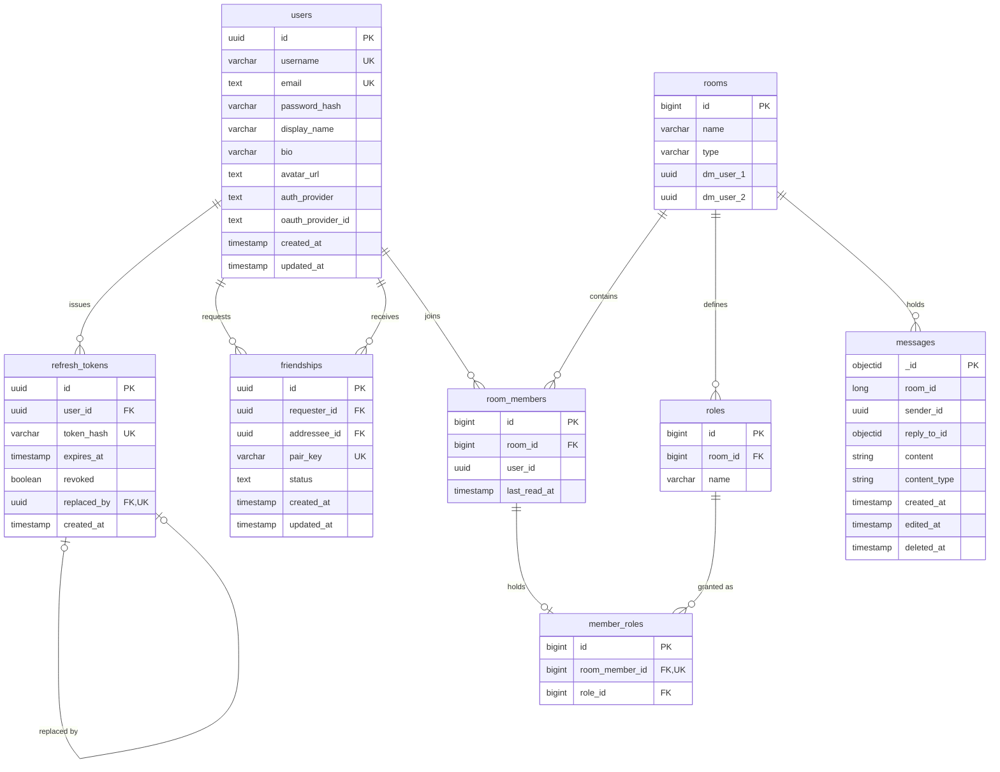

*This project has been created as part of the 42 curriculum by asajed, asoudani, mlakhdar, rahmoham, obendaou.*

# Guild Chat — ft_transcendence

A real-time chat platform built as a distributed web application.

---

## Project layout

Folders follow the service categories in `docker-compose.yml`:

```text
gateway-frontend/
  gateway/
  frontend/
application/
  org-service/
  chat-service/
  identity-service/
  health.sh
databases/
  postgres/
  backup-recovery/
    backup-service/
    scripts/
monitoring/
  prometheus/       # Prometheus and Alertmanager configuration
  grafana/
  status-page/
  scripts/
  metrics-exporters/
    docker-exporter/
deploy/
certs/              # Local certificates
backups/            # Local backup data
```

Services that use upstream images without local files remain configured in Compose.
The root Compose file, Makefile, and `.env` remain the stack entry points.

## Table of Contents

- [Description](#description)
- [Team Information](#team-information)
- [Project Management](#project-management)
- [Technical Stack](#technical-stack)
- [Database Schema](#database-schema)
- [Instructions](#instructions)
- [Features List](#features-list)
- [Modules](#modules)
- [Individual Contributions](#individual-contributions)
- [Resources](#resources)
- [Known Limitations](#known-limitations)

---

## Description

**Guild Chat** is a real-time communication platform in the spirit of Discord or Slack.
Users register or sign in, build a friends list, create group rooms or open
direct messages, and exchange messages that are delivered live over WebSockets to every
connected participant.

Rather than build a game, we chose a domain where the hard problems are the ones we wanted
to learn: concurrent multi-user state, live message fan-out, service-to-service
authorization, and running the whole thing on real infrastructure that we monitor, harden
and back up ourselves.

The application is deployed at **https://guild-chat.tech** and runs locally with a single
`make`.

### Key features

- **Real-time messaging** — messages, edits and presence are pushed over a WebSocket
  connection.
- **Rooms and direct messages** — create group rooms, invite friends, or open a one-to-one
  DM with anyone on your friends list.
- **Friends and presence** — send, accept and decline friend requests; see who is
  online right now.
- **Profiles and avatars** — editable display name, username and bio, with avatar upload.
- **Role-based permissions** — every room member holds an `OWNER`, `ADMIN` or `MEMBER` role
  that governs who can rename the room, add members, kick members and assign roles.

- **Hardened infrastructure** — an Nginx + ModSecurity WAF in front of everything, full
  Prometheus/Grafana monitoring, a public status page, and automated backups with a tested
  disaster-recovery procedure.

### Architecture

```
                                  Browser
                                     │  HTTPS / WSS
                                     ▼
                    ┌────────────────────────────────┐
                    │   nginx + ModSecurity (WAF)    │   :8443
                    │   TLS · rate limiting · OWASP  │
                    └────────────────────────────────┘
                       │        │         │        │
        ┌──────────────┘        │         │        └──────────────┐
        ▼                       ▼         ▼                       ▼
   ┌──────────┐      ┌──────────────┐  ┌──────────────┐   ┌──────────────┐
   │ frontend │      │   identity   │  │     org      │   │     chat     │
   │ React SPA│      │   :8083      │  │    :8082     │   │    :8081     │
   └──────────┘      │ auth · users │  │ rooms · DMs  │   │ messages     │
                     │ friends      │  │ members·roles│   │ WebSocket    │
                     └──────────────┘  └──────────────┘   └──────────────┘
                            │  ▲              │  ▲            │   │
                            │  └──── gRPC ────┘  └─── gRPC ───┘   │
                            │       (ValidateToken, GetUser,      │
                            │        AreFriends, IsMember)        │
                            ▼                  ▼                  ▼
                     ┌─────────────────────────────┐      ┌──────────────┐
                     │ PostgreSQL 16 (2 containers)│      │  MongoDB 7   │
                     │   transdb │ org_service_db  │      │   chatdb     │
                     └─────────────────────────────┘      └──────────────┘

   Observability plane:  prometheus · alertmanager · grafana · gatus · backup-service
```

`chat-service` and `org-service` delegate token validation to `identity-service`
over **gRPC**. Identity also exposes `GetUser` and `AreFriends`. Chat's identity
and membership calls use a configurable 500 ms deadline by default; org's current
identity client does not set a deadline.

---

## Team Information

| Login | Role(s) | Responsibilities |
|---|---|---|
| **asoudani** | Technical Lead / Architect · Developer | Defined the microservice architecture and technology stack. Owns the Nginx + ModSecurity gateway, the Prometheus/Grafana/Gatus observability stack, backups and disaster recovery, the Docker Compose topology, and the GitHub Actions CI/CD pipeline. Reviews critical changes across services. |
| **rahmoham** | Developer | Owns the entire React frontend: routing and session handling, the shared design system, the API client layer (token refresh, error envelopes), and responsive/mobile layout. |
| **mlakhdar** | Project Manager / Scrum Master · Developer | Runs planning, tracks the board and unblocks the team. Owns `chat-service`: the WebSocket handler and handshake authentication, subscription and presence registries, room broadcasting, and message persistence in MongoDB. |
| **obendaou** | Developer | Owns the Node.js/TypeScript `identity-service`. She maintains authentication and sessions, profiles, avatars, friendships, the Prisma data model and the gRPC API used by chat and org. |
| **asajed** | Product Owner · Developer | Maintains the backlog, prioritises features and validates completed work. Owns `org-service`: rooms, direct messages, membership and the role/permission model. |

---

## Project Management

**How we organised the work.** We split the product along service boundaries so that each
member owned one deployable unit end to end — frontend, identity, org, chat, and
infrastructure. Cross-service contracts (REST shapes and `.proto` definitions) were agreed
in writing before implementation so that two people could work either side of a boundary
without blocking each other. The PM tracks planning and blockers on the team's board;
the PO prioritises the backlog and validates completed features. We use daily Discord
updates and voice sessions for pairing and integration work.

**Tools.**

| Purpose | Tool |
|---|---|
| Code review and integration | GitHub branches and Pull Requests, reviewed before merge to `main` |
| CI/CD | GitHub Actions — [`.github/workflows/ci-cd.yml`](.github/workflows/ci-cd.yml) |
| Communication | Discord (daily async updates, voice for pairing) |
| Cross-team docs | [Identity API](application/identity-service/README.md), [chat API](application/chat-service/API_CONTRACT.md), [presence protocol](docs/PRESENCE.md), [gateway routing](gateway-frontend/gateway/README.md) |

---

## Technical Stack

### Frontend

| Technology | Why |
|---|---|
| React | Component model and ecosystem; the natural fit for a stateful, live-updating SPA. |
| Vite | Near-instant dev server and a fast production build with no config overhead. |
| styled-components | Styles co-located with components and scoped by construction. Chosen over Tailwind because we wanted to author our own design system rather than adopt a vendor's utility vocabulary — see [Modules](#modules). |
| react-router-dom | Client-side routing with the guarded-route pattern used in [`App.jsx`](gateway-frontend/frontend/src/App.jsx). |
| react-icons, @fontsource/inter | Icon set and self-hosted typeface (no external font CDN at runtime). |

Design tokens — colour palette, spacing scale, radii, shadows and semantic aliases — are CSS
custom properties defined once in [`gateway-frontend/frontend/src/index.css`](gateway-frontend/frontend/src/index.css)
and consumed by every component.

### Backend

The backend combines obendaou's **Node.js/TypeScript identity service** with
**Java/Spring Boot chat and org services**. They share Protocol Buffers contracts
and communicate over gRPC. See the [identity service guide](application/identity-service/README.md)
for its routes, configuration and development commands.

| Technology | Version | Why |
|---|---|---|
| Node.js / TypeScript | Node 24 in identity CI; TypeScript 7 | Typed service code compiled to JavaScript. The Dockerfile uses `node:lts-alpine`. |
| Fastify | 5 | Identity HTTP routes, authentication hooks, request injection for tests and multipart avatar uploads. |
| Prisma / PostgreSQL adapter | 7 | Typed identity repositories, explicit relations and versioned SQL migrations; `@prisma/adapter-pg` connects through `pg`. |
| Zod | 4 | Validates registration, login, profile fields, UUID parameters and friendship requests. |
| bcrypt / jsonwebtoken | 6 / 9 | Password hashing with cost 12 and HS256 access tokens; refresh tokens use Node's crypto API. |
| Vitest / tsx | 5 / 4 | Identity tests and development reloads. |
| Java | 21 | Shared Java runtime for chat and org. |
| Spring Boot | Chat: 3.5.4; org: 4.1.0 | HTTP APIs, dependency injection, validation, persistence and Actuator health endpoints. Org uses Spring Security and JPA; chat uses Spring Data MongoDB and WebSockets. |
| gRPC + Protocol Buffers | `@grpc/grpc-js` + `@grpc/proto-loader` in identity; gRPC Java in chat/org | A language-neutral contract for token validation, user lookup, friendship checks and room membership. |
| Maven | Wrapper per Java service | Builds chat and org with their declared dependencies. |
| Micrometer + Prometheus registry | Chat and org | Exposes JVM and HTTP metrics. Identity currently exposes `/health`, without a Prometheus metrics endpoint. |

The service manifests and lockfiles record dependency versions. The mixed stack lets
each service keep its own framework and persistence layer while preserving the API
contracts used by the frontend and the other services.

### Data

| Store | Version | Used for | Why |
|---|---|---|---|
| PostgreSQL | 16 | `transdb` (users, refresh tokens, friendships) and `org_service_db` (rooms, members, roles) | These entities are highly relational with real integrity constraints — unique username/email, a unique friendship pair, a unique `(room, user)` membership. A relational engine enforces that for us. |
| MongoDB | 7 | `chatdb` (messages) | Message history is append-heavy, schema-flexible (replies, edits, soft deletes) and queried almost exclusively as "the last *N* messages in room *X*". A document store with a compound index on `(room_id, created_at)` serves that pattern with no joins. |

Each service owns its own schema and no service reads another's database directly — all
cross-service reads go through gRPC.

### Gateway and infrastructure

| Technology | Role |
|---|---|
| Nginx + ModSecurity v3 + OWASP CRS v4 | TLS termination (TLS 1.2/1.3), reverse proxy, WAF, and rate limiting (20 r/s, burst 30 → HTTP 429) |
| Docker + Docker Compose | 17 service definitions, including the one-shot identity migration job; only Nginx publishes host ports. A separate network connects the container exporter to the Docker socket proxy. |
| Prometheus + Alertmanager | Metrics collection across 5 scrape jobs, with alert rules routed to Discord |
| Grafana | Dashboards for microservice health and container metrics |
| Gatus | Status page monitoring 7 endpoints |
| GitHub Actions | CI (lint, build, test, Compose validation) and CD (SSH deploy to the production VM) |

---

## Database Schema

### PostgreSQL — `transdb` (owned by identity-service)

Runs in `identity-service_postgres`, using the `database` volume. The source of truth
is [the Prisma schema](application/identity-service/prisma/schema.prisma), with SQL
migrations in [`prisma/migrations/`](application/identity-service/prisma/migrations/).

| Table | Key fields | Notes |
|---|---|---|
| `users` | `id UUID PK`, `username VARCHAR(32) UNIQUE`, `email TEXT UNIQUE`, `password_hash VARCHAR(100)?`, `display_name VARCHAR(80)`, `bio VARCHAR(280)?`, `avatar_url TEXT?`, `auth_provider TEXT`, `oauth_provider_id TEXT?`, `created_at/updated_at TIMESTAMP(3)` | Local registration stores `auth_provider = LOCAL` and a bcrypt password hash. The schema retains a unique `(auth_provider, oauth_provider_id)` pair for future OAuth support; OAuth routes are not implemented. |
| `refresh_tokens` | `id UUID PK`, `user_id UUID FK`, `token_hash VARCHAR(64) UNIQUE`, `expires_at TIMESTAMP(3)`, `revoked BOOLEAN`, `replaced_by UUID? UNIQUE FK`, `created_at TIMESTAMP(3)` | SHA-256 hashes of random tokens; indexed on `user_id`. Rotation links the old row to its replacement. Replaying a rotated token revokes all refresh sessions for that user. |
| `friendships` | `id UUID PK`, `requester_id UUID FK`, `addressee_id UUID FK`, `pair_key VARCHAR(73) UNIQUE`, `status TEXT`, `created_at/updated_at TIMESTAMP(3)` | The service uses `PENDING` and `ACCEPTED` states. `pair_key` joins sorted user UUIDs, preventing duplicate requests in either direction. Composite indexes cover `(requester_id, status)` and `(addressee_id, status)`. |

`users` has one-to-many relations to refresh tokens and to both sides of friendships;
deleting a user cascades to these records. `replaced_by` references another refresh
token, with `ON DELETE SET NULL`. Declining a pending request deletes its friendship row.

### PostgreSQL — `org_service_db` (owned by org-service)

Runs in `org-service_postgres`, using its own `org-service_postgres_data` volume.
Identity and org use separate databases and credentials configured in the root `.env`.

| Table | Key fields | Notes |
|---|---|---|
| `rooms` | `id BIGINT PK`, `name VARCHAR(100)`, `type`, `dm_user_1 UUID`, `dm_user_2 UUID`, `created_at`, `updated_at` | `type ∈ {DM, GROUP}`. Unique on `(dm_user_1, dm_user_2)` so a DM between two people can only exist once. |
| `room_members` | `id BIGINT PK`, `room_id BIGINT FK → rooms.id`, `user_id UUID`, `last_read_at TIMESTAMP` | Unique on `(room_id, user_id)`. `last_read_at` drives unread indicators. |
| `roles` | `id BIGINT PK`, `room_id BIGINT FK → rooms.id`, `name VARCHAR(50)` | `name ∈ {OWNER, ADMIN, MEMBER}`; unique on `(room_id, name)`. |
| `member_roles` | `id BIGINT PK`, `room_member_id BIGINT UNIQUE FK → room_members.id`, `role_id BIGINT FK → roles.id` | Assigns one role to a membership. |



### MongoDB — `chatdb` (owned by chat-service)

Collection **`messages`**: `_id ObjectId`, `room_id Long`, `sender_id UUID`,
`reply_to_id ObjectId?`, `content String`, `content_type String`, `created_at`,
`edited_at?`, `deleted_at?`. A compound index on `(room_id, created_at)` is created
idempotently at startup by `MongoIndexConfig` and backs every history query.

**Cross-store relations.** `room_members.user_id → users.id`, `messages.room_id → rooms.id`
and `messages.sender_id → users.id`
are logical relations, not database foreign keys — they span three services and two engines.
They are enforced in application code: before accepting a message, `chat-service` verifies
the sender's token against `identity-service` and their room membership against
`org-service`, both over gRPC.

---

## Instructions

### Prerequisites

| Requirement | Version | Notes |
|---|---|---|
| Docker Engine | 24+ | Rootless Docker is supported — the Makefile auto-detects the socket. |
| Docker Compose | v2 | Invoked as `docker compose`, not `docker-compose`. |
| GNU Make | any | Entry point for every operation. |
| Git | any recent version | Clone the repository. |
| RAM | Allow several GB for the full stack | Two JVM services, one Node service, three database containers and monitoring. |
| `jq`, `curl` | any | Only for `make status`. |

Docker builds the application inside containers; host Node.js and Java installations
are optional. For development outside Docker, match CI: **Node.js 24 for identity**,
**Node.js 22 for the frontend**, and **Java 21 for chat/org**. Use `npm ci` for the
locked npm dependencies and each Java service's Maven wrapper.

### Running the project

1. Clone the repository and create your local configuration:

```bash
git clone https://github.com/Seraph919/ft_transcendence.git ft_transcendence
cd ft_transcendence

cp .env.example .env
```

2. Edit `.env` using the configuration table below. Set a private `JWT_SECRET`,
   database credentials and Grafana credentials. For local access, set
   `DOMAIN=localhost` and keep one `GF_SERVER_ROOT_URL=https://localhost/grafana/`
   entry; the template currently contains duplicate Grafana keys and an old `8443` URL.
   Keep the identity ports at 8083/9090 for the existing gateway and gRPC clients.
3. Start the stack with `make`. Docker builds missing images and downloads upstream
   images on the first run. Use `make build` after changing application code.
4. Follow startup with `make logs`, check containers with `make ps`, then open
   `https://localhost`. Register an account; use a second account/browser session
   to try friend requests, DMs and room messaging.

`make` is the single command required by the subject. It resolves the Docker socket, checks
that `.env` exists, and runs `docker compose up -d`.

On the very first start, [`gateway-frontend/gateway/script.sh`](gateway-frontend/gateway/script.sh) generates a self-signed
RSA-2048 certificate in the `nginx_tls` volume if you have not supplied a certificate
in `certs/`. Accept the browser certificate warning for local development. Production
certificate setup uses Certbot (see [`deploy/README.md`](deploy/README.md)).

Compose waits for database health and runs `identity-migrate` before starting identity.
This job applies the versioned Prisma migrations and should exit with code 0. On failure,
inspect `docker compose logs identity-migrate`; an existing database created outside
Prisma needs a schema review and migration baseline. Nginx waits for its configured
dependencies, using health checks where available and startup checks for Prometheus/Gatus.

### Access

| Surface | URL | Auth |
|---|---|---|
| Application | `https://localhost` | App login |
| Application (HTTP, redirects) | `http://localhost` | — |
| Grafana dashboards | `https://localhost/grafana/` | `GF_SECURITY_ADMIN_USER` / `..._PASSWORD` |
| Status page (Gatus) | `https://status.localhost/` | No authentication in the checked-in configuration |
| Prometheus | `https://localhost/prometheus/` | Restricted to private IP ranges |

### Environment configuration

`.env` is git-ignored; [`.env.example`](.env.example) is the tracked template. Copy it and
change the defaults before any deployment.

| Group | Keys | Notes |
|---|---|---|
| Gateway / WAF | `DOMAIN`; `MODSEC_RULE_ENGINE`, `PARANOIA`, `BLOCKING_PARANOIA` in Compose | Compose currently sets blocking mode and paranoia 1 directly in Nginx's environment; changing only `.env` does not override those values. |
| PostgreSQL | `IDENTITY_POSTGRES_*`, `ORG_POSTGRES_*` | Separate host, port, user, password and database settings for each service. Keep `DATABASE_URL` and `ORG_DATASOURCE_URL` aligned with these values. |
| Identity runtime | `IDENTITY_HTTP_PORT`, `GRPC_PORT`, `AVATAR_DIR`, `DATABASE_URL` | Fastify defaults to 8083; the gRPC server reads `GRPC_PORT` and defaults to 9090. `IDENTITY_GRPC_PORT` configures chat's client; org currently hardcodes 9090. Keep these ports aligned and use `/tmp/identity-avatars` for the mounted volume. |
| Org datasource | `ORG_DATASOURCE_URL`, `ORG_POSTGRES_USER`, `ORG_POSTGRES_PASSWORD` | Mapped to org's Spring datasource variables by Compose; connects to `org-service_postgres:5432`. |
| JWT | `JWT_SECRET`, `JWT_ISSUER`, optional `JWT_TTL_SECONDS`, `JWT_REFRESH_TTL_SECONDS` | Replace the placeholder secret. Identity defaults to issuer `ft-transcendence`, 900-second access tokens and 604800-second refresh tokens. |
| Legacy OAuth variables | `GITHUB_CLIENT_ID`, `GITHUB_CLIENT_SECRET`, `GITHUB_REDIRECT_URI` | Present in the template but unused by the current Node identity service. Setting them does not enable GitHub sign-in. |
| MongoDB | `MONGO_INITDB_ROOT_USERNAME/PASSWORD`, `CHAT_MONGO_DB/USER/PASSWORD/AUTH_DB` | Match chat credentials to the configured MongoDB user. Initial root credentials apply on the first start only; an existing database needs an explicit credential update. |
| Monitoring | `DS_PROMETHEUS`, `GF_SERVER_ROOT_URL`, `GF_SECURITY_ADMIN_USER/PASSWORD`, `GF_AUTH_*`, `GF_SECURITY_*` | Grafana is served under a subpath, so `GF_SERVER_ROOT_URL` must match your host. |
| Alerting | `DISCORD_WEBHOOK_URL` | Optional webhook for Alertmanager notifications. |

### Make targets

| Target | Effect |
|---|---|
| `make` / `make up` | Start the full stack in the background |
| `make build` | Rebuild images and start |
| `make re` | `clean` then `build` |
| `make down` | Stop and remove containers |
| `make clean` | Stop and remove containers plus orphans |
| `make fclean` | Also remove volumes and prune the Docker system — **destroys all data** |
| `make ps` | Container status table |
| `make logs` | Follow logs from every service |
| `make restart` | Restart all containers |
| `make monitoring` | Rebuild only Grafana, Prometheus, Alertmanager, docker-exporter |
| `make microservices` | Rebuild the Fastify identity service and the Spring chat/org services, plus required dependencies |
| `make proxy` | Rebuild only the Nginx gateway |
| `make backup` | Snapshot the identity and org PostgreSQL databases and the chat MongoDB database |
| `make restore SNAPSHOT=<name>` | Restore from a snapshot |
| `make test-recovery` | Run the automated disaster-recovery verification |
| `make status` | Print health for every monitored endpoint |

### Deployment

Production runs on an Oracle Cloud free-tier ARM64 instance. The full procedure — instance
sizing, firewall rules, VM bootstrap and the GitHub Actions secrets
(`OCI_HOST`, `OCI_USERNAME`, `OCI_SSH_KEY`, `OCI_SSH_PORT`) — is documented in
[`deploy/README.md`](deploy/README.md). Merging to `main` triggers an automatic deploy.

---

## Features List

### Authentication and accounts — *obendaou* (API), *rahmoham* (UI)

| Feature | Description |
|---|---|
| Registration | Email, username and password with validation on both the client and the server. Passwords are BCrypt-hashed and salted. |
| Login | Accepts a username or email and password; issues an HS256 access token (15 min by default) and a random refresh token (7 days). |
| Session logout APIs | `/auth/logout` takes a refresh token and revokes that session; authenticated `/auth/logout-all` revokes all refresh sessions for the user. See the frontend integration limitation below. |
| Silent token refresh | The frontend refreshes the access token before expiry, so sessions survive page reloads without a re-login. |
| Refresh-token rotation | Every refresh issues a new token and invalidates the old one. Presenting a rotated token revokes all refresh sessions for that user; stored tokens are SHA-256 hashes. |
| Internal identity API | gRPC `ValidateToken` returns identity and JWT expiry; `GetUser` returns a profile; `AreFriends` checks accepted friendships for chat/org. |

### Profiles and friends — *obendaou* (API), *rahmoham* (UI)

| Feature | Description |
|---|---|
| Profile view and edit | Display name, username and bio, with live username-availability checking. |
| User lookup | Authenticated lookup by UUID or normalized username; public profile responses omit email and password hashes. |
| Avatars | JPEG, PNG and WebP multipart upload capped at 5 MiB, retrieval and deletion. Files persist on a dedicated Docker volume; replacement cleans up the old file. |
| Friend requests | Look up a username, send a request by user UUID, accept or decline incoming requests, and list incoming/outgoing requests. A unique pair key prevents duplicate relationships in either direction. |
| Friends list | List and remove friends. |
| Online presence (*mlakhdar*, *rahmoham*) | Chat-service sends online/offline snapshots and changes over the shared WebSocket; the frontend displays them beside identity profiles. |

### Rooms, DMs and permissions — *asajed*

| Feature | Description |
|---|---|
| Group rooms | Create, list, rename and delete rooms. |
| Direct messages | Open a one-to-one conversation with a friend; the unique-pair constraint guarantees a single DM per pair. |
| Membership | Owners and admins add friends to a room directly and kick members; any member can leave. |
| Roles | `OWNER`, `ADMIN` and `MEMBER`, with role assignment restricted to owners and admins. `OWNER` cannot be reassigned. |
| Read markers | `last_read_at` per membership, driving unread state in the sidebar. |

### Messaging — *mlakhdar*

| Feature | Description |
|---|---|
| Send and receive | Messages persist to MongoDB and broadcast over WebSocket to every subscriber of the room. |
| Live delivery | A single `/ws/chat` socket per client, authenticated at handshake, multiplexed across rooms via `subscribe` / `unsubscribe` frames. |
| Replies | Reply to a message; the reply renders a quoted line that jumps to the original when clicked. |
| Editing | Edit your own messages within a 15-minute window; the edit broadcasts as a `message.edited` frame. |
| Deletion | Senders and room owners/admins can soft-delete messages; chat broadcasts the deletion to room subscribers. |
| History | Paginated room history served from the compound `(room_id, created_at)` index. |
| Presence | Per-user socket tracking across tabs and devices; the last disconnect gets a 5-second grace period. Clients subscribe to the users they display. See the [presence guide](docs/PRESENCE.md). |

### Interface — *rahmoham*

| Feature | Description |
|---|---|
| Design system | 11 reusable components with a shared token layer — see [Modules](#modules). |
| Responsive layout | Adapts from desktop three-pane to a mobile single-pane layout with slide-over panels. |
| Session handling | Restores sessions, refreshes access tokens and reconnects the shared WebSocket with room and presence subscriptions. |
| Privacy Policy | Accessible at `/privacy`, linked from the footer on every page. Describes what personal data we collect (account details, avatars, message content, presence), why, how long we keep it, and how to request deletion. |
| Terms of Service | Accessible at `/terms`, linked from the footer on every page. Covers acceptable use, account responsibilities, content ownership and termination. |

### Operations — *asoudani*

| Feature | Description |
|---|---|
| WAF | ModSecurity v3 with OWASP CRS v4 in blocking mode, tuned per route. |
| Rate limiting | 20 requests/second per IP with a burst of 30 on all API routes; excess returns HTTP 429. |
| HTTPS everywhere | TLS 1.2/1.3 termination at the gateway; HTTP redirects to HTTPS. |
| Metrics | Five Prometheus scrape jobs covering chat, org, the gateway exporter, the container exporter and Prometheus itself. Docker/Gatus check identity through `/health`. |
| Dashboards | Grafana dashboards for microservice health and container resource usage. |
| Alerting | Rules for service/container downtime, OOM kills, high CPU and memory, and elevated 5xx rates, routed to Discord via Alertmanager. |
| Status page | Gatus monitors 7 endpoints for the gateway, frontend, application services, Prometheus and Grafana. |
| Backups | A backup daemon snapshots both PostgreSQL databases and MongoDB on a schedule, with restore and an automated recovery test. |
| CI/CD | Frontend lint/build, Java tests for chat/org, identity Vitest tests and TypeScript build against a temporary PostgreSQL database, and Compose/monitoring validation; deployment runs after successful checks on pushes to `main`. |

---

## Modules

**Chosen modules: 19 points = 7 Major × 2 + 5 Minor × 1.** The organization-system
candidate below would bring the total to 21 if accepted. The custom WAF module also
requires evaluator acceptance; this table records the team's choices, not an awarded score.

| # | Category | Module | Type | Points | Owner |
|---|---|---|---|---:|---|
| 1 | Web | Framework for frontend **and** backend | Major | 2 | rahmoham, obendaou, mlakhdar, asajed |
| 2 | Web | Real-time features (WebSockets) | Major | 2 | mlakhdar |
| 3 | Web | User interaction (chat, profiles, friends) | Major | 2 | rahmoham, obendaou, mlakhdar |
| 4 | Web | ORM for the database | Minor | 1 | obendaou, asajed |
| 5 | Web | Custom design system | Minor | 1 | rahmoham |
| 6 | Accessibility & i18n | Support for additional browsers | Minor | 1 | rahmoham |
| 7 | User Management | Standard user management and authentication | Major | 2 | obendaou |
| 8 | User Management | Advanced permissions system | Major | 2 | asajed |
| 9 | Modules of choice | Hardened ModSecurity WAF | Minor | 1 | asoudani |
| 10 | DevOps | Monitoring with Prometheus and Grafana | Major | 2 | asoudani |
| 11 | DevOps | Backend as microservices | Major | 2 | asoudani |
| 12 | DevOps | Health checks, status page, automated backups and disaster recovery | Minor | 1 | asoudani |
| | | | | **19** | |

### 1 · Framework for both frontend and backend — Major (2 pts)

*Why:* a project split across four deployable units needs conventions, not glue code.

*How:* the frontend is a **React 19** application built with Vite, using `react-router-dom`
for routing and the guarded-route pattern in
[`gateway-frontend/frontend/src/App.jsx`](gateway-frontend/frontend/src/App.jsx).
**Fastify 5** serves identity's TypeScript HTTP API, with Zod validation and Prisma
repositories. **Spring Boot** serves chat and org, with MongoDB and JPA persistence
respectively. obendaou owns identity's framework implementation; rahmoham owns React,
mlakhdar owns chat and asajed owns org.

### 2 · Real-time features (WebSockets) — Major (2 pts)

*Why:* a chat application is only convincing if messages arrive without a refresh.

*How:* `chat-service` exposes a native WebSocket endpoint at `/ws/chat`. The token is
validated during the handshake by `TokenHandshakeInterceptor` — an unauthenticated socket is
never established. `SubscriptionRegistry` maps sessions to rooms so `RoomBroadcaster` fans a
message out only to the sessions that need it, rather than to every connected client.
`PresenceRegistry` tracks each user's sockets and schedules an offline notification
5 seconds after their last socket closes. Reconnecting within that grace period
cancels the notification. The protocol (`WsEvents`) carries room subscriptions,
message events, errors, and `presence.subscribe` / `presence.unsubscribe` requests
with `presence.snapshot` / `presence.changed` responses. On the client,
`api/messages.js` owns the shared socket and restores subscriptions after reconnect;
`useRoomMessages` and `usePresence` consume its updates. Presence no longer polls REST,
while `GET /api/chat/presence` remains available for snapshots. See the
[presence guide](docs/PRESENCE.md) and [chat API contract](application/chat-service/API_CONTRACT.md).

*Multi-user support:* concurrent writes are safe by construction — message identity comes
from MongoDB, and membership uniqueness is enforced by a database constraint rather than a
read-then-write check.

### 3 · User interaction (chat, profiles, friends) — Major (2 pts)

*Why:* the module's three requirements are the core of the product.

*How:* **Chat** — rooms and DMs with persisted history, replies and edits.
**Profiles** — viewable user profiles with display name, bio and avatar, openable from any
member list or message. **Friends** — send, accept and decline requests, list pending
requests and remove accepted friends through identity's `friendships` table. Chat
provides live online status. Cancellation of outgoing pending requests remains an
integration gap.

### 4 · ORM for the database — Minor (1 pt)

*Why:* hand-written SQL across two relational schemas and three services would be the
largest source of drift in the project.

*How:* obendaou uses **Prisma 7** in `identity-service`, with `User`, `RefreshToken`
and `Friendship` models, generated TypeScript queries, a PostgreSQL adapter and
versioned SQL migrations. asajed uses **Spring Data JPA / Hibernate** in `org-service`.
Chat uses Spring Data MongoDB repositories for message documents.

### 5 · Custom design system — Minor (1 pt)

*Why:* we deliberately did not adopt a component library, so that the interface would be
ours and internally consistent.

*How:* a token layer in [`gateway-frontend/frontend/src/index.css`](gateway-frontend/frontend/src/index.css) defines
the colour palette (dark theme with a crimson accent), typography scale (Inter, self-hosted),
spacing, radii, shadows and semantic aliases. Built on it are **11 reusable components** in
[`gateway-frontend/frontend/src/components/ui/`](gateway-frontend/frontend/src/components/ui/) — exceeding the
10-component minimum:

`Avatar` · `Button` · `Card` · `ConfirmDialog` · `Feedback` · `IconButton` · `Input` ·
`Skeleton` · `SlidePanel` · `StatusDot` · `Tabs`

Icons come from `react-icons`. Every feature component composes these rather than
redefining its own buttons or avatars — `ConfirmDialog` in particular replaced the last
native `window.confirm` / `window.alert` calls in the codebase.

### 6 · Support for additional browsers — Minor (1 pt)

*Why:* the mandatory target is Chrome, but a chat client people actually use has to work
wherever they already are.

*How:* the application is tested and functional in **Mozilla Firefox** and **Microsoft
Edge** in addition to Chrome. The build targets baseline-widely-available features through
Vite's default browser targets; no vendor-prefixed or Chrome-only APIs are used. The
WebSocket client, `fetch`-based API layer and CSS custom-property token system are all
standard across the three engines, giving a consistent UI and identical feature set.

### 7 · Standard user management and authentication — Major (2 pts)

*Why:* the mandatory user system, taken to the module's bar.

*How:* users update their profile information (display name, username, bio); upload an
avatar, with a generated default when none is set; add other users as friends and see their
online status; and have a profile page that any other user can open. Authentication uses
bcrypt-hashed passwords (cost 12), HS256 JWTs and rotating refresh tokens with reuse
detection. obendaou maintains these APIs in Fastify, Zod and Prisma, including
single-session logout and authenticated logout of all refresh sessions. The
frontend's current logout request still needs to match the API; see
[Known Limitations](#known-limitations).

### 8 · Advanced permissions system — Major (2 pts)

*Why:* a shared room needs an answer to "who is allowed to do this", and that answer has to
be enforced on the server.

*How:* `org-service` models `OWNER`, `ADMIN` and `MEMBER` roles through the
`roles` / `member_roles` tables. Full CRUD over rooms and memberships is exposed at
`/rooms` — create, read, update, delete rooms; add, remove and list members; read and assign
roles. Each action is authorised against the caller's role in that specific room, so the
permission check is per-resource rather than global. Different roles get different views and
actions: only owners and admins see the add-member and kick controls, only owners can delete
or rename a room, and `OWNER` cannot be assigned to another member.

### 9 · Hardened ModSecurity WAF — Minor, Module of choice (1 pt)

*Why:* everything in this project is exposed to the public internet on a real domain. We
wanted a defensive layer that inspects requests rather than trusting the application tier to
be flawless. We claim it as a Module of choice because our implementation covers the WAF
half of the Cybersecurity module thoroughly, without the HashiCorp Vault component — see
[Known Limitations](#known-limitations).

*How:* [`gateway-frontend/gateway/`](gateway-frontend/gateway/) builds on `owasp/modsecurity-crs:nginx`, running **ModSecurity
v3 with OWASP Core Rule Set v4** in blocking mode. Configuration:

- Paranoia levels (`PARANOIA`, `BLOCKING_PARANOIA`) and engine mode through
  the gateway environment in Compose, currently fixed to paranoia 1 and blocking mode.
- An explicit allowed-method list.
- Per-route rule-engine control — inspection is disabled for the WebSocket upgrade path and
  for the Grafana, Prometheus and status-page proxies, where CRS produces false positives on
  legitimate traffic.
- Rate limiting at 20 r/s per IP with a burst of 30, returning HTTP 429.
- IP allowlisting (loopback and RFC1918 ranges only) on `/nginx_status`, `/prometheus/` and
  `/metrics.prom`.
- TLS 1.2/1.3 termination with an HTTP→HTTPS redirect.

Full routing table and policy detail: [`gateway-frontend/gateway/README.md`](gateway-frontend/gateway/README.md).

### 10 · Monitoring with Prometheus and Grafana — Major (2 pts)

*Why:* operators need service health, resource usage and alerts across the whole stack.

*How:* **Prometheus** scrapes five jobs: chat and org via Micrometer Actuator
endpoints, the Nginx gateway via `nginx-exporter`, a custom container exporter, and itself.
Identity has a Fastify `/health` endpoint checked by Docker and Gatus; it does not
currently expose application metrics for Prometheus.
The **docker-exporter** is a bash service we wrote that publishes per-container metrics on
port 8090. **Grafana** serves two dashboards (`microservices-dashboard.json`,
`docker-metrics.json`) under an authenticated subpath with anonymous access disabled.
**Alertmanager** routes rules — `MicroserviceDown`, `ContainerDown`, `ContainerOOMKilled`,
`HighContainerCpuUsage`, `HighContainerMemoryUsage`, `HighHttp5xxErrorRate` — to Discord.
Details: [`monitoring/README.md`](monitoring/README.md).

### 11 · Backend as microservices — Major (2 pts)

*Why:* three people owning three services could work in parallel with far less contention
than three people in one codebase — and it forced us to make contracts explicit.

*How:* the backend consists of a Fastify identity service and two Spring Boot services,
each with its own responsibility and datastore. asoudani owns their integration and
deployment; obendaou, asajed and mlakhdar own their respective service implementations.

| Service | Runtime | Responsibility | Internal ports | Store |
|---|---|---|---|---|
| `identity-service` | Node.js / TypeScript / Fastify | Authentication, profiles, avatars, friendships | 8083 HTTP, 9090 gRPC | PostgreSQL `transdb` via Prisma |
| `org-service` | Java / Spring Boot | Rooms, DMs, membership, roles | 8082 HTTP, 9090 gRPC | PostgreSQL `org_service_db` via JPA |
| `chat-service` | Java / Spring Boot | Messages, WebSocket delivery, presence | 8081 HTTP/WS, 9090 gRPC | MongoDB `chatdb` |

Communication is by **gRPC** with Protocol Buffers contracts
([identity proto](application/identity-service/src/grpc/identity.proto) and
`application/{chat-service,org-service}/src/main/proto/*.proto`). Chat uses a
configurable 500 ms deadline for identity and membership calls; org's identity
client currently has no explicit deadline.
`identity-service` exposes `ValidateToken`, `GetUser` and `AreFriends`; `org-service`
exposes membership lookups to `chat-service`. No service reaches into another's database.
Authentication has exactly one owner: `chat-service` performs no local JWT parsing and
delegates every token check to `identity-service`.

### 12 · Health checks, status page, automated backups and disaster recovery — Minor (1 pt)

*Why:* a deployment you cannot restore is a deployment you do not really have.

*How:*

- **Health checks** on the databases, application services and selected infrastructure
  components, with Compose dependency conditions controlling startup. Identity also
  waits for `identity-migrate` to complete.
- **Status page** — Gatus monitors 7 endpoints at `https://status.${DOMAIN}/`.
- **Automated backups** — a `backup-service` container snapshots PostgreSQL and MongoDB on a
  schedule ([`databases/backup-recovery/backup-service/`](databases/backup-recovery/backup-service/)).
- **Disaster recovery** — [`databases/backup-recovery/scripts/restore.sh`](databases/backup-recovery/scripts/) restores from a snapshot, and
  `databases/backup-recovery/scripts/test-disaster-recovery.sh` runs an automated five-step verification that the
  procedure actually works. Documented in [`databases/backup-recovery/scripts/README.md`](databases/backup-recovery/scripts/README.md).

### Bonus candidate (not counted in the 19)

**Organization system — Major (2 pts).** `org-service` implements create, read, update and
delete for rooms; adding and removing users; and scoped per-room actions gated by role. If
rooms are accepted as organizations, this module applies and the total becomes 21.

---

## Individual Contributions

### asoudani — Technical Lead / Architect · Developer

Chose the microservice split and the gRPC-between-services model, and built every layer
below the application: the [`gateway-frontend/gateway/`](gateway-frontend/gateway/) Nginx + ModSecurity image, the
[`docker-compose.yml`](docker-compose.yml) topology with health-gated startup, the
[`Makefile`](Makefile), the full [`monitoring/`](monitoring/) observability stack (Prometheus,
Alertmanager, Grafana dashboards, Gatus, a hand-written bash container exporter), the backup
and disaster-recovery [`databases/backup-recovery/scripts/`](databases/backup-recovery/scripts/), and the
[CI/CD pipeline](.github/workflows/ci-cd.yml) with its OCI deployment. Integrated
identity's Node container, database migration job, persistent avatar volume and
Node 24 test/build job into the shared stack.

*Challenges.* Tuning ModSecurity was the hardest part: CRS v4 at default paranoia flagged
legitimate chat payloads and broke the WebSocket upgrade outright. The fix was per-location
rule-engine control rather than blanket rule exclusions, keeping full inspection on the API
surface while exempting the upgrade path and the proxied admin UIs. Getting Grafana to serve
correctly under a subpath behind the WAF required aligning `GF_SERVER_ROOT_URL` with the
proxy configuration. Running Docker rootless on some machines and rootful on others also
meant the Makefile had to detect the socket path rather than assume it.

### rahmoham — Frontend Developer

Built the entire React application: routing and session restoration in
[`App.jsx`](gateway-frontend/frontend/src/App.jsx), the API client layer
([`src/api/`](gateway-frontend/frontend/src/api/)) with bearer-token handling, silent refresh and
per-service error envelopes, the design-system layer, and every feature surface — landing,
auth, app shell, rooms, DMs, profiles and member lists — plus the responsive/mobile layout
and the Privacy Policy and Terms of Service pages.

*Challenges.* Integrating independently developed services required a shared API layer
to normalize user responses and display request errors. Silent token refresh also needed
coordination: concurrent requests hitting an expired token share one refresh operation
before replaying. The client uses Web Locks when available to coordinate across tabs.
`org-service` also originally returned only member IDs, forcing an N+1 lookup per DM to
resolve the other participant; that was resolved by having the service return the peer
directly on the room response.

### mlakhdar — Project Manager / Scrum Master · Developer, chat-service

Ran planning, kept the board current and unblocked the team. Owns `chat-service`: the
WebSocket handler and `TokenHandshakeInterceptor`, `SubscriptionRegistry`,
`PresenceRegistry`, `RoomBroadcaster` and `FrameSender`, the REST message API, MongoDB
persistence with the compound history index, and the gRPC clients to identity and org. Wrote
the deepest test suite in the project — roughly 20 test classes including WebSocket handshake
and broadcast coverage.

*Challenges.* Authenticating a WebSocket is not the same problem as authenticating a request:
browsers cannot set headers on the upgrade, and the connection is long-lived, so the check
has to happen once at handshake and the identity must then be pinned to the session.
Broadcasting also had to stay selective — an early version pushed every message to every
connected session, which the subscription registry replaced. The 500 ms gRPC deadline was
chosen so that a slow dependency degrades into a clear error rather than a hung socket.

### obendaou — Developer, identity-service

She owns the current **Node.js/TypeScript identity service**, organized into Fastify
routes, controllers, Zod schemas, services and Prisma repositories. She maintains
registration/login, bcrypt password hashing, JWT validation, refresh-token rotation
and session logout, profile updates and avatar storage.

Her implementation and commits include:

- **Profiles:** authenticated profile lookup, username availability and lookup by
  username, with separate account and public-profile response shapes.
- **Avatars:** deletion and replacement cleanup, including removing a newly written
  file if the database update fails.
- **Friendships:** sending, accepting and declining requests, removing friends,
  listing accepted friends and grouping pending requests as incoming/outgoing.
- **Persistence:** Prisma user/token/friendship relations, cascading deletes, a
  normalized unique `pair_key` and its SQL migration.
- **Internal API:** the `@grpc/grpc-js` server and `ValidateToken`, `GetUser` and
  `AreFriends` handlers. `ValidateToken` includes JWT expiry for chat's connection handling.
- **Tests:** friendship integration coverage and gRPC behavior checks alongside the
  service's authentication, session, profile and avatar tests in
  [`src/tests/`](application/identity-service/src/tests/).

*Challenges.* Two users can send requests to each other at the same time. She addressed
this with a sorted UUID pair key, a database uniqueness constraint and a Prisma
`P2002` conflict response. Her migration backfills pair keys and stops for manual
resolution if duplicate pairs exist. Avatar replacement also required cleanup across
filesystem and database writes. For gRPC integration, she kept the existing Java-compatible protobuf
contract and added the token's expiry to the Node response.

### asajed — Product Owner · Developer, org-service

Maintained the backlog and validated completed work, and owns `org-service`: the room and DM
model, membership, the role system, the full `/rooms` REST surface, the gRPC client to
identity, and the gRPC server that answers membership questions from `chat-service`.

*Challenges.* Preventing duplicate DMs between the same two people is a race condition if
checked in application code, so it is enforced with a unique constraint on the normalised
`(dm_user_1, dm_user_2)` pair and the conflict handled on insert. Designing the role check to
be per-room rather than global also meant authorisation could not live in a Spring Security
rule — it had to be resolved per request against the caller's membership in that specific
room.

---

## Resources

### Documentation and references

- [Fastify documentation](https://fastify.dev/docs/latest/) — HTTP routes, plugins and testing for identity
- [Prisma ORM documentation](https://www.prisma.io/docs/orm) — typed database access and migrations; this repository uses Prisma 7
- [gRPC for Node.js](https://grpc.io/docs/languages/node/) — identity's internal RPC server
- [Vitest guide](https://vitest.dev/guide/) — identity unit and integration tests
- [Spring Boot Reference Documentation](https://docs.spring.io/spring-boot/docs/current/reference/html/)
- [Spring Security Architecture](https://docs.spring.io/spring-security/reference/servlet/architecture.html)
- [Spring Data JPA](https://docs.spring.io/spring-data/jpa/reference/) · [Spring Data MongoDB](https://docs.spring.io/spring-data/mongodb/reference/)
- [gRPC Java documentation](https://grpc.io/docs/languages/java/) and the [Protocol Buffers language guide](https://protobuf.dev/programming-guides/proto3/)
- [React documentation](https://react.dev/) · [Vite guide](https://vite.dev/guide/) · [React Router](https://reactrouter.com/)
- [styled-components documentation](https://styled-components.com/docs)
- [MDN — The WebSocket API](https://developer.mozilla.org/en-US/docs/Web/API/WebSockets_API)
- [OWASP Core Rule Set](https://coreruleset.org/docs/) and the [ModSecurity v3 reference](https://github.com/owasp-modsecurity/ModSecurity/wiki)
- [OWASP Cheat Sheet Series](https://cheatsheetseries.owasp.org/) — authentication, password storage, session management
- [Prometheus documentation](https://prometheus.io/docs/) · [Grafana documentation](https://grafana.com/docs/) · [Gatus](https://github.com/TwiN/gatus)
- [MongoDB indexing strategies](https://www.mongodb.com/docs/manual/applications/indexes/)
- [Nginx reverse proxy and WebSocket proxying guides](https://nginx.org/en/docs/)
- RFC 6749 — *The OAuth 2.0 Authorization Framework*; RFC 7519 — *JSON Web Token*; RFC 6455 — *The WebSocket Protocol*
- [Docker Compose specification](https://docs.docker.com/compose/compose-file/)

### How AI was used

We used AI assistants (ChatGPT, Claude) as a productivity tool, on the terms the subject
sets out: nothing was merged that its author could not explain and defend.

**Where it helped:**

- *Boilerplate and scaffolding* — initial Spring Boot service skeletons, DTO and mapper
  classes, repository interfaces, and React component shells. Mechanical code we would
  otherwise have typed by hand.
- *Infrastructure configuration* — first drafts of Dockerfiles, Compose service definitions,
  Prometheus scrape configs, Grafana dashboard JSON and Alertmanager routing. Generated
  configuration was consistently the least reliable output and needed the most correction,
  particularly around the ModSecurity and Grafana subpath setup.
- *Debugging* — as a rubber duck for stack traces and misbehaving configuration, especially
  the WebSocket upgrade failing behind the WAF and gRPC calls being rejected by Spring
  Security filters. AI suggested directions; the diagnoses were ours.
- *Documentation* — drafting and structuring this README and the per-component docs from
  notes and from the code itself. This revision used Codex to inspect the current
  TypeScript identity routes, Prisma schema, migrations, tests and Git history, then
  update ownership, setup instructions, feature claims and known limitations.
- *Learning* — explaining unfamiliar territory (gRPC in Spring, the OWASP CRS rule model,
  Micrometer's registry) faster than reading reference documentation cold.

**Where we did not use it:** the architecture itself — the service split, the gRPC contracts,
the data model, and the decision to centralise token validation in one service — was designed
by the team. We also wrote the security-sensitive logic by hand and reviewed it together:
token rotation and reuse detection, the per-room authorisation checks, and the WebSocket
handshake authentication.

**Our process:** generated code was read line by line, adapted to the conventions of the
codebase, tested, and reviewed by a second team member in a pull request before merge. Where
an AI suggestion conflicted with something we had verified ourselves, we went with the
verified answer — this happened often enough with configuration to be a working assumption.

---

## Known Limitations

- **GitHub OAuth is not implemented in the Node identity service.** The schema and
  `.env.example` retain provider fields and credentials, but there are no OAuth routes.
- **Identity monitoring is limited to health and container metrics.** `/health` checks
  that Fastify responds; it does not probe PostgreSQL or expose Prometheus metrics.
- **Identity gRPC configuration differs between server and clients.** The Node listener
  reads `GRPC_PORT`, chat reads `IDENTITY_GRPC_PORT`, and org hardcodes 9090 without
  an explicit call deadline. The default ports agree.
- **HashiCorp Vault is not deployed.** Secrets are managed through a git-ignored `.env` file
  and GitHub Actions secrets. This is why the WAF work is claimed as a Module of choice
  rather than as the full Cybersecurity module.
- **No internationalisation.** The interface is English only.
- **No two-factor authentication.** Account security rests on password hashing, short-lived
  access tokens and refresh-token reuse detection.
- **Single-instance deployment.** Production runs on one VM with no horizontal scaling or
  failover. Backups and a tested restore procedure are the recovery story.
- **Org still uses `ddl-auto: update`.** Identity uses versioned Prisma migrations;
  org has no Flyway or Liquibase migration history. Existing identity databases created
  outside Prisma need a schema review and baseline before `migrate deploy`.
